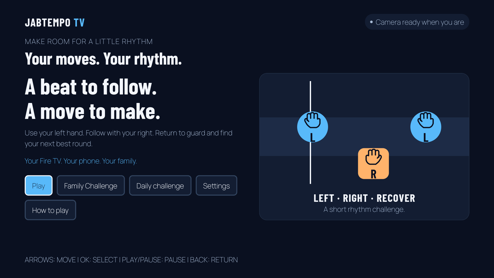

# JabTempo TV

**Your moves. Your rhythm. Your next best round.**

JabTempo TV is a rhythm boxing game for the Fire TV hackathon track. The native
React Native TV app shows LEFT/RIGHT beat notes and scores a round. A phone
browser processes its camera locally and sends pose landmarks and punch events
through a laptop relay. Camera video and audio are not sent to the TV.



This public repository is a clean source snapshot for judges. The development
history and the original owner-supplied planning prompts are kept separately.
The [public MIT tv-pose-bridge](https://github.com/ZiyadAzzaz/tv-pose-bridge)
is an additional, reusable Open Source contribution.

## What runs

The Fire OS target is an Android TV app. The current verified build runs in an
Android TV emulator, which the [hackathon FAQ](https://amazonappdev2026.devpost.com/details/faqs)
accepts. The phone companion is a local HTTPS browser page; no phone app is
required. This prototype needs a Windows laptop relay and emulator gateway on
a trusted LAN. TV-hosted direct mode and a physical Fire TV/ARM release build
are not implemented.

The game includes left/right practice, four-per-hand calibration, gradual note
density, timing feedback, pause/count-in, round summary and turn-based Family
Challenge. The [native checkpoint](results/native/progressive_round_checkpoint_2026-10-16.json)
and [full-round demo evidence](results/native/simulated_demo_2026-10-16.json)
used **synthetic controller events**. They verify software flow, not human punch
accuracy, iPhone performance, or physical Fire TV hardware. The edited video
is kept outside Git to avoid raw media in source control.

Watch the [90-second public emulator demo](https://youtu.be/Pu2sLuW0jzA).
It labels the simulated controller throughout; its score is not a human result.

The owner reports that they played the prototype and invited friends to play.
They described those informal sessions as working well and impressive. This is
owner-reported feedback, without a recorded participant count, device setup,
scores, or measured accuracy; the linked demo remains a simulated-input run.

## Build and run on Windows

Install free Conda, Android command-line SDK/emulator and an Android TV x86_64
AVD. The scripts default to `D:\android-fire-TV` for the SDK workspace. Set
`$env:JABTEMPO_ANDROID_ROOT` to a different absolute root before the scripts
if needed; it must contain `sdk`, `avd` and `tmp`. The `amazon-tv` environment
contains Node 20, Python 3.11 and JDK 17.

```powershell
conda env create -f environment.yml
conda activate amazon-tv
npm ci
npm run setup:assets
python scripts/gen_beats.py --output apps/tv/assets/audio --beats 144
yarn --cwd apps/tv install --immutable
npm test
npm run typecheck
```

Build the native debug APK and start the emulator/phone server:

```powershell
conda activate amazon-tv
. .\scripts\use_android_sdk.ps1
$env:EXPO_PUBLIC_JABTEMPO_RELAY_URL='ws://10.0.2.2:8789/bridge'
$env:EXPO_PUBLIC_JABTEMPO_SETUP_URL='http://10.0.2.2:8789/connection'
$env:EXPO_PUBLIC_JABTEMPO_PHONE_URL='https://YOUR_WIFI_IPV4:8787/phone'
python scripts/prepare_native_workspace.py jabtempo
python scripts/build_native.py jabtempo --attempt 10 --low-memory
. .\scripts\start_playing.ps1
```

Replace `YOUR_WIFI_IPV4` with the laptop's current LAN address. The launcher
prints the live phone URL. The browser camera requires the phone to trust the
local development certificate manually. Follow the [native play guide](docs/native_emulator_play.md)
and [phone trust steps](docs/how_to_play.md). Do not install this development
certificate on testers' phones.

For a laptop-only browser preview, run `npm run build:web`,
`npm run build:tv-web`, then `npm run dev` inside `amazon-tv`. Open
`http://localhost:8787/tv-web`; the browser preview is not native footage.

## Testing and limits

Core tests, TypeScript checks, a synthetic nine-screen browser round, native
emulator smoke and a full synthetic-controller native round passed on October
16, 2026. Reports are included under `results/`. These checks cannot establish
real iPhone accuracy, latency, heat, audible speech, or first-time usability.
Use `npm run test:lab` and `npm run test:tv-web` for additional local checks.

No paid AWS service is needed. See [credits and third-party licenses](docs/credits.md).
This is a movement game, without medical or injury-prevention claims. The
source is MIT; generated beat audio is original and third-party assets retain
their own licenses.
