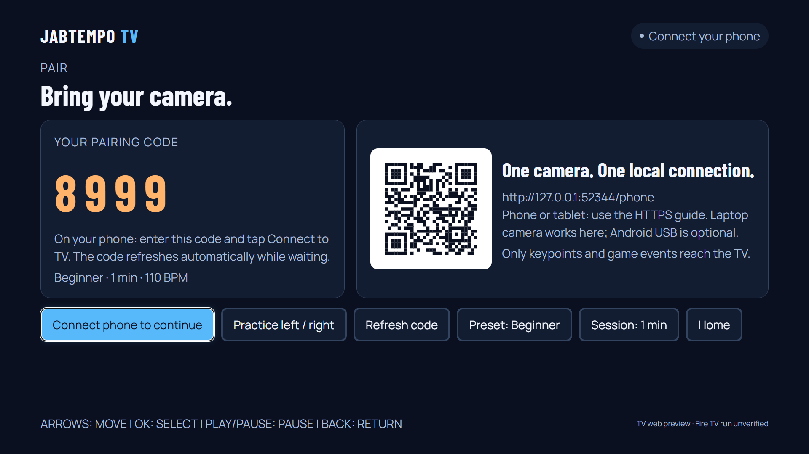
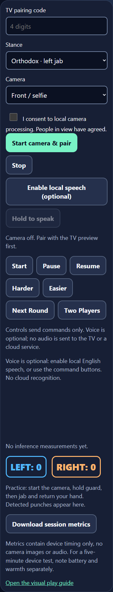
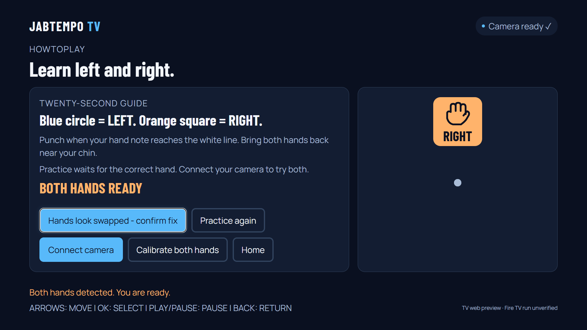
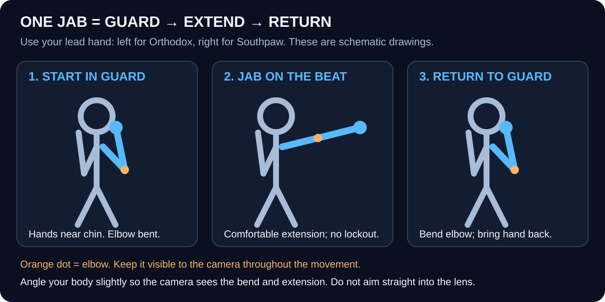
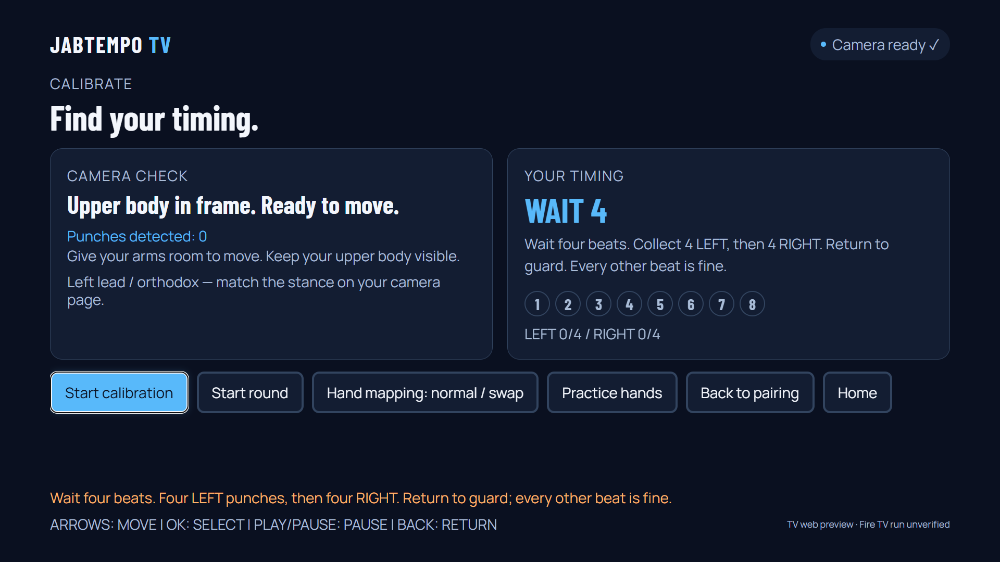
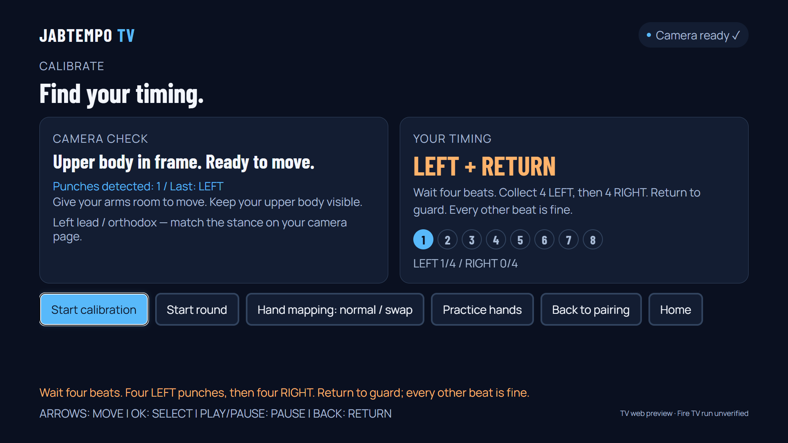
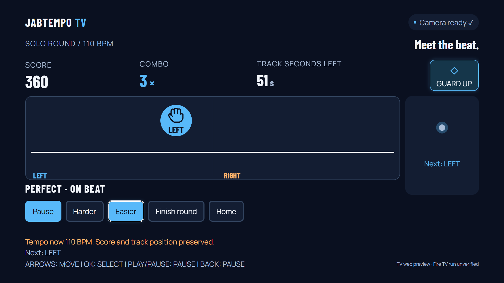
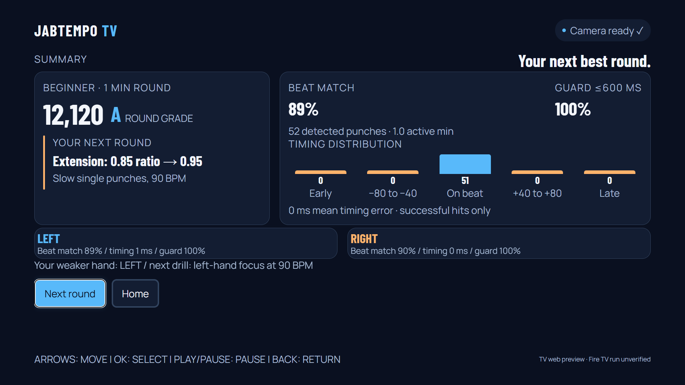

# JabTempo: LEFT / RIGHT, step by step

**Native Android TV emulator:** use [the laptop + iPhone play steps](native_emulator_play.md).
The official sample G0 has passed; physical native gameplay is verified separately.

The laptop/TV shows the game and plays the beat. Your iPhone, Android phone, or tablet supplies
its camera through the same browser controller. There is no phone app to install. See
[device compatibility and limitations](prompt4_controller_design.md).

Screenshots are TV web previews with synthetic input, not real sensor accuracy or your scores.
Any pictured pairing code is an example. Always enter the live code on your own screen.

## 1. Start the native TV game

For the Android TV emulator and iPhone, use one command in PowerShell:

```powershell
conda activate amazon-tv
. .\scripts\start_playing.ps1
```

The script prints the **current iPhone URL**. Open that URL in Safari, select
**Play** on the emulator, enter its code, and tap **Connect to TV**. Then check
camera consent and tap **Start camera**. The TV shows the game; the phone shows
your camera. If the Wi-Fi address changed, the new local certificate still needs
your manual iPhone trust step from [how_to_play.md](how_to_play.md).

## Browser preview alternative

The agent builds the pages during verification. Stop your camera, press **Ctrl+C** in the server
terminal, then restart your existing owner-only iPhone HTTPS setup:

```powershell
conda activate amazon-tv
. .\scripts\setup_iphone_tls.ps1 -LanIP YOUR_WIFI_IPV4
npm run dev:iphone
```

Use the current Wi-Fi address printed by setup if it changed. A changed address may need the
owner to repeat trust setup; [how_to_play.md](how_to_play.md) covers that. Never install our
local development certificate on a tester's phone: use your configured iPhone or laptop webcam.

| Open here | Replace `YOUR_WIFI_IPV4` with the current Wi-Fi address |
| --- | --- |
| Laptop game | `https://YOUR_WIFI_IPV4:8787/tv-web` |
| iPhone Safari / Android Chrome / tablet camera | `https://YOUR_WIFI_IPV4:8787/phone` |
| Illustrated guide, either device | `https://YOUR_WIFI_IPV4:8787/play-guide` |

Reload both pages and pair with the new live code. Do not run two cameras together while learning.

## 2. Pair and start the camera

On the laptop, the first-launch guide appears. Select **Connect camera**. Later, Home > Play opens
pairing. Arrow keys move focus; Enter selects; Backspace returns.



On the phone, enter that code and tap **Connect to TV**. Select stance/front or
rear camera if needed, check camera consent, then tap **Start camera** and allow
camera access. Keep Safari/Chrome open and the screen awake.
Opening the page alone does not start capture. Hiding it stops capture; restart when you return.



Wait for **Camera connected**, then choose **Continue to calibration**. First-time players are
sent to the hand practice before calibration. Set 90 BPM in Settings for an easier starting pace.

## 3. Practice your actual LEFT and RIGHT hands

**Blue circle = your LEFT hand. Orange rounded square = your RIGHT hand.**
The screen's left lane is for your physical left hand even in Southpaw stance.



1. Keep your face, both shoulders, elbows and wrists visible, including at extension.
2. Angle your body slightly so the camera can see your elbow straighten.
3. Start with both hands near your chin. Extend the requested hand comfortably, then return to guard.
4. When **TRY YOUR LEFT HAND** appears, use your real left. The tutorial waits for a detected left.
5. Then use your real right. **BOTH HANDS READY** unlocks **Calibrate both hands**.



Watch the phone's **LEFT / RIGHT** counters. If they stay zero, improve framing/light and arm
visibility before timing calibration. The selfie image is mirrored; choose your actual hand,
not the side where you happen to see it in that image.

If you clearly use your left but the app consistently reports right, choose the **Hands look
swapped - confirm fix** control in the TV tutorial. It swaps the mapping for this camera device,
clears old calibration, and asks you to check both hands again. Use this only after verifying your
actual hand; ordinary wrong-hand mistakes do not prove a camera swap. **Practice again** repeats
the hand check for a changed camera placement.

## 4. Calibrate four LEFT, then four RIGHT

Choose **Calibrate both hands**, then **Start calibration** on the laptop.

| Visible cue | Your action |
| --- | --- |
| WAIT 4, 3, 2, 1 | Hold guard and listen to the beat. |
| LEFT + RETURN | Use your left hand until LEFT reaches 4/4. |
| RIGHT + RETURN | Switch to your right until RIGHT reaches 4/4. |
| Need more return time? | Punch on every other beat; return/rest on the intervening beat. |
| Timing offset appears | All eight samples accepted. Choose Start round. |





There are 24 opportunities after the count-in. Aim to reach comfortable extension near the beat,
then return. Strength is not the goal. Wrong hands do not fill samples. Changing hand mapping
stops calibration and clears its samples so mixed mappings cannot be saved.

If it fails, report **Punches detected**, **LEFT /4 and RIGHT /4**, and the camera-check message.
Detected punches but few samples usually need timing work; zero detections need framing/movement work.

## 5. Play the two lanes



Notes come **down** their hand lane toward the horizontal white hit line. Reach extension when
its center reaches the line, then return to guard. Large LEFT/RIGHT labels and fist shapes tell you
which hand. The silhouette highlights the next hand. **Other hand!** indicates a wrong-hand attempt.

Settings > Labels offers **Left/Right** (default), **Jab/Cross** or **Icons only**. In boxing mode,
Orthodox means left jab/right cross; Southpaw means right jab/left cross. Physical lanes never swap
because of stance. Callout captions follow the selected mode; local TV speech is used when available.

**Harder / Easier** during solo play changes the audible tempo immediately while preserving score
and track position. The chart is 60 track seconds; actual playing time varies with live tempo.
**Pause / Resume** is on the TV and phone. Space also pauses/resumes on the laptop.



Summary reports separate hand beat match, timing and guard recovery. A weaker-hand drill appears
only when both hands have measured results. These are game-session metrics, not validated accuracy.

## 6. Phone controls, voice and family turns

The phone has all seven command buttons. **Enable local speech** optionally loads a local English
model; then hold **Hold to speak**, say one command, and release. Commands: start, pause, resume,
harder, easier, next round, two players. If local speech fails, tap the command or use TV controls.
There is no cloud recognition fallback. The model may need roughly 300 MB runtime memory;
performance on your physical iPhone still needs measurement.

Home > **Family Challenge** lets you cycle two distinct player names with the D-pad. Players take
turns with one camera and the same chart/pace. Next round advances to the other player. The shared
leaderboard lists named scores. Family tempo stays fixed for fairness; simultaneous 2P is future work.

## 7. Re-test on your iPhone

Repeat practice, 4+4 calibration and a full round. Confirm your left appears in the left lane,
your right in the right lane, and one deliberately wrong hand earns no hit points. Try Pause,
Resume, Harder, Easier and one optional voice command. Tell us what actually happens.

For five-minute performance evidence, note device/iOS, start/end battery and warmth. Keep capture
visible for five minutes, then download session metrics. Inference fps is not capture-to-render
latency. [Self-test](m1_self_test.md) covers optional consented training keypoints; recording is not
required for ordinary play. [Native play guide](native_emulator_play.md) covers emulator setup.

## Prompt 5 recovery controls

During a Round, **Back pauses** and preserves progress. Select **Finish round** explicitly
when you want results. **Resume** counts in 3-2-1 while the beat and score wait. Sustained
poor framing/light or stopped camera updates pause the round; follow the on-screen hint,
keep the camera page open, and resume after tracking returns. These recovery behaviors
are browser-regression checks; their native TV check follows SDK setup.

For the Android TV emulator, follow [Android setup on D:](android_on_D.md).
